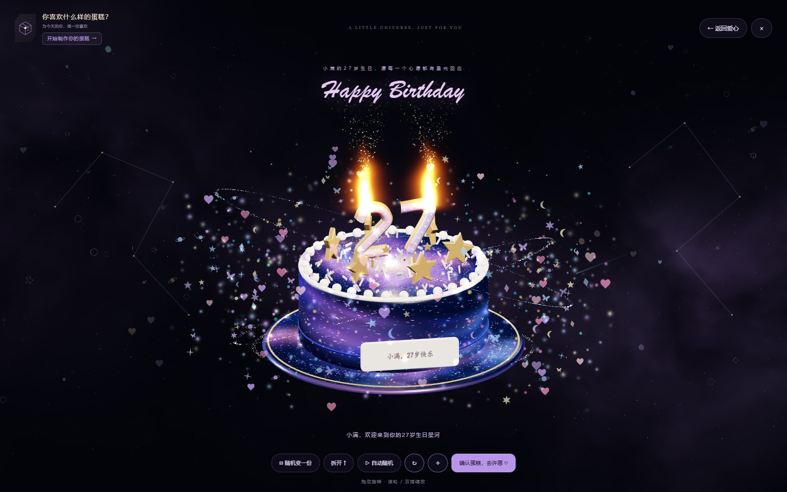
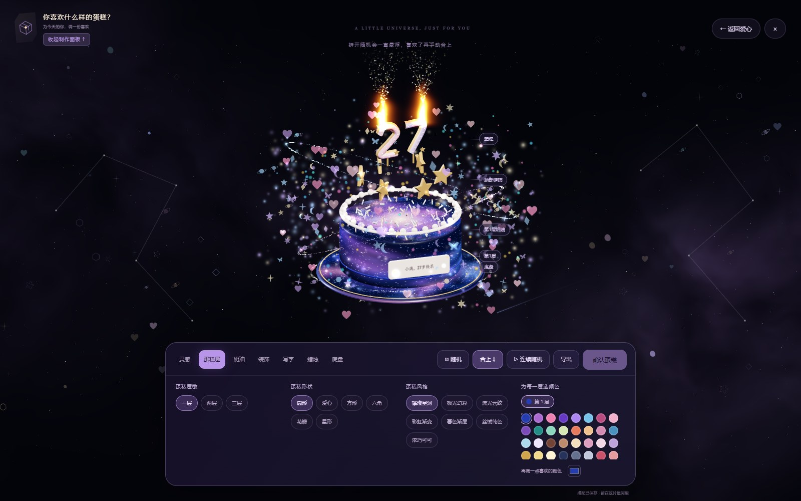

# Birthday Galaxy · 星河生日祝福

A birthday wish among stars, with floating cards and a cake made just for you.

把一句生日快乐，变成一场可以亲手参与的小惊喜。输入名字与生日，点亮开场蛋糕，让祝福卡片汇成爱心，再到星河里制作属于自己的蛋糕、许愿、收下一封祝福信。



## 可以玩什么

- **专属开场**：名字与生日组成开启惊喜的仪式，祝福和数字蜡烛会使用对应的名字与生日年龄。
- **祝福爱心**：64 张柔彩小卡片在约 5 秒内依次组成爱心，完成后轻轻跳动；可以拖动、点开阅读和复位。
- **星河蛋糕**：流动的星云蛋糕表面、发光星尘、爱心、星星、月亮与蝴蝶，适配电脑和手机。
- **亲手搭配**：蛋糕层数、形状、配色、奶油、装饰、蜡烛、文字和托盘均可更换。
- **拆开看，合上赏**：拆分和合起状态均支持随机搭配；随机不会强制合上。托盘留在原处，新的蛋糕逐层落下。
- **留住心意**：确认蛋糕后，长按许愿、熄灭蜡烛、阅读专属祝福，也可以导出蛋糕图片。

<p>
  
  
</p>

## 本地运行

安装 Node.js 22 或更新版本，然后：

```sh
git clone https://github.com/yanami-sec/birthday-galaxy.git
cd birthday-galaxy
npm start
```

打开 **http://127.0.0.1:8765/**。网页没有运行时 npm 依赖，直接运行不需要先安装开发工具；Three.js 已保存在本地。请通过 HTTP 服务器打开，直接双击 HTML 会影响模块加载。

端口被占用时：

```sh
npm start -- --port 8766
```

也可以使用 Python：`python -m http.server 8765 --directory web`。

## 名字、生日与隐私

开场的“账号”填写收祝福者的名字，“密码”填写出生日期，例如 `2000.02.01`。这是一种生日仪式，**不是身份验证或访问控制**，不能用于保护秘密内容。

年龄以北京时间的**下一次生日**计算：今年生日已过，就祝明年的生日；生日当天仍祝当天。例如在 2026 年 10 月 29 日输入 `2000.02.01`，祝的是 2027 年的 27 岁生日。

网站没有后端，不发送名字或出生日期。出生日期不会持久保存，输入后会清空；为了保留蛋糕设计，浏览器本地可能保存名字、生日年龄、庆祝年份和蛋糕配方。在共享设备上可清除本站数据。部署服务本身的访问日志由对应服务商管理。

## 背景音乐

开源版默认静音，未附带商业歌曲。你可以将有使用授权的音频放入 `web/audio/`，并修改 `web/app.js` 中的配置：

```js
const BACKGROUND_MUSIC = { src: "audio/my-birthday.mp3", title: "我的生日音乐" };
```

音频会在点击开场蛋糕后播放。音频文件默认不会提交到 Git，部署时需要自行准备；项目 MIT 许可证不包含歌曲授权。

## 部署

这是纯静态网站，将 **`web/` 目录的内容**发布到支持静态文件的服务即可，保留内部目录结构。无需数据库、账号服务或服务器密钥。

GitHub Pages 可以在仓库 Settings → Pages 中配置 GitHub Actions，通过官方[自定义工作流说明](https://docs.github.com/en/pages/getting-started-with-github-pages/using-custom-workflows-with-github-pages)将 `web/` 作为发布目录。仓库当前的工作流只运行测试，不会自动发布网页。

## 开发与验证

```sh
npm ci
npm test
npx playwright install chromium
npm run test:browser
```

浏览器测试会自动启动独立的本地服务器，覆盖生日入口、祝福卡片、蛋糕制作与许愿，以及默认静音。已有 Chrome 的环境也可设置 `BIRTHDAY_BROWSER_CHANNEL=chrome`。测试截图输出到被 Git 忽略的 `artifacts/`。

主要代码：

| 目录 / 文件 | 内容 |
| --- | --- |
| `web/app.js`、`web/heart-cards.js` | 开场、卡片爱心与阅读交互 |
| `web/birthday-profile.js` | 名字、日期校验与下一次生日年龄 |
| `web/workshop.js`、`web/workshop-model.js` | 蛋糕场景、编辑器和模型 |
| `web/galaxy-*.js`、`web/animated-surface.js` | 星光背景、粒子与动态材质 |
| `tests/` | 逻辑与浏览器验证 |
| `scripts/` | 本地服务器和逐帧录制工具 |

## 录制展示视频（可选）

录制工具逐帧渲染画面，避免实时录屏时掉帧；需要安装 FFmpeg 和 Playwright，提前运行网站。输出默认是 30 fps、1080p，渲染需要一定时间。

PowerShell 示例（示例人物）：

```powershell
$env:BIRTHDAY_RECORD_NAME = '小满'
$env:BIRTHDAY_RECORD_DATE = '2000.02.01'
# FFmpeg 已在 PATH 中时无需设置；否则填入可执行文件路径：
# $env:FFMPEG_PATH = 'C:\tools\ffmpeg.exe'
npm run record:desktop
npm run record:entry
```

第一步生成 40 秒的桌面展示，第二步添加 5 秒遮住生日输入的登录开场。竖屏使用 `npm run record`，再执行 `node scripts/add-recording-entry.cjs`。默认输出无声轨内容；需要配乐可设置 `BIRTHDAY_RECORD_MUSIC` 为有授权的本地音频绝对路径。视频、录制参数与截图位于 `artifacts/recordings/`，均不会上传到仓库。请检查成片中的姓名等内容后再公开分享。

## 致谢与许可

灵感参考 [BirthdayWish](https://github.com/Seeingsprings/BirthdayWish)、[HappyBirthday_Yan-71b87](https://github.com/zonezz/HappyBirthday_Yan-71b87) 与 [Birthday-template](https://github.com/KernelCrafters/Birthday-template)。本仓库只发布重新实现的网页版，保留 [Three.js](https://github.com/mrdoob/three.js/tree/r128) 的 MIT 声明，详见 [第三方说明](web/THIRD-PARTY.md)。

本项目代码以 [MIT License](LICENSE) 开源。欢迎修改祝福、搭配新蛋糕，或者把这片星河送给你在意的人。
